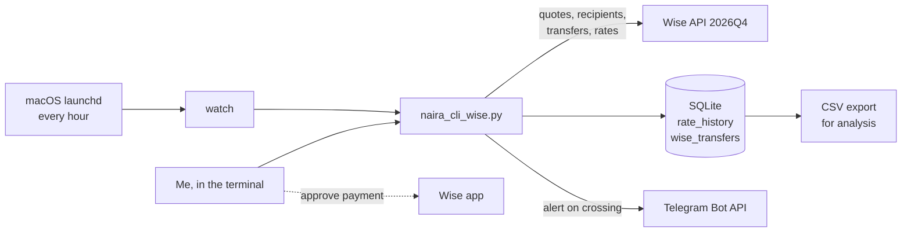

# Naira CLI

A command-line tool I built to send money from my Wise account in the UK to Nigerian bank accounts and OPay, and to alert me on Telegram when the GBP→NGN rate moves past levels I care about.

I built and tested it against my own live Wise account. Along the way I ran into a real regulatory constraint (PSD2 Strong Customer Authentication) and redesigned the flow around it. That part is written up below, because it turned out to be the most interesting thing about the project.

<!-- Add a screenshot of a Telegram alert here:  -->

## What it does

- **Rate alerts.** Checks the GBP→NGN rate every hour and sends a Telegram message when it crosses a threshold. It fires once per crossing, not every hour the rate stays past the line.
- **Rate history.** Stores every reading in SQLite, can backfill weeks of hourly history from Wise on day one, and exports to CSV for analysis.
- **Transfers.** Quotes, creates recipients (including OPay) and creates transfers through the Wise API. Payment is then approved in the Wise app (see below for why).
- **Tracking.** Lists pending transfers, checks status, cancels unpaid transfers, and keeps a local history.

## How it works



## What I found building it

I tested every API call against my live account (UK personal profile) and cross-checked against Wise's API reference. Some of what I expected turned out to be wrong. The full call-by-call results are in [docs/findings.md](docs/findings.md).

| What I expected | What actually happened |
|---|---|
| The API could move money end to end | **Funding returns HTTP 403.** Wise's docs say personal tokens can only fund transfers for accounts based in the US, Canada, Australia, New Zealand, Singapore and Malaysia. UK and EEA accounts fall under PSD2 Strong Customer Authentication, so a payment has to be approved by the account holder. |
| OPay would need a mobile-wallet recipient type | **Wise treats OPay as a bank.** NGN recipients are type `nigeria`, and OPay is bank code `100004` in Wise's own bank list. There is no wallet type for NGN. |
| Profile type would be `personal` | It's `PERSONAL`. Filtering on lowercase silently picked the wrong profile. |
| Any string works as a transfer ID | `customerTransactionId` must be a UUID. It's what makes retries safe without creating duplicate transfers. |
| Paying from balance is always available | Wise only offers `BALANCE` when the money is already there. Otherwise it offers card or Google Pay, which the tool now refuses to fall back to silently. |

### Designing around SCA

Rather than look for a way around the 403, I treated it as the control working as intended: someone holding a stolen API token shouldn't be able to empty an account. So the tool does everything it is allowed to do (rate, fee, recipient, creating the transfer), and I approve the final payment in the Wise app with one tap. The transfer is waiting there, already filled in.

This also shaped the security choices:
- The API token is stored outside the repo in `~/.naira_cli/config.json`, with owner-only permissions (`600`).
- Token prompts are hidden.
- Nothing in this repo can move money on its own.

## Tests

```bash
pip install -r requirements.txt -r requirements-dev.txt
pytest
```

No test talks to the real Wise or Telegram APIs. A fake Wise API in `tests/conftest.py` returns responses shaped like the examples in Wise's documentation. Each test pins down a behaviour I found or confirmed against the live API, including the bugs in the table above. I checked the tests catch regressions by putting old bugs back and confirming the relevant tests fail.

## Setup

Needs Python 3.10+ and a Wise personal API token (Wise → Your Account → Connect and manage apps → API tokens).

```bash
pip install -r requirements.txt

python3 naira_cli_wise.py init                # paste token, it isn't shown
python3 naira_cli_wise.py backfill --days 30  # import past hourly rates
python3 naira_cli_wise.py rate-history --hours 720

python3 naira_cli_wise.py telegram-setup      # optional, walks through BotFather
python3 naira_cli_wise.py alert-add above 1800
python3 naira_cli_wise.py alert-add below 1750
python3 naira_cli_wise.py schedule-install    # macOS: hourly background check
```

On macOS, keep the project outside Desktop, Documents and Downloads. macOS blocks background jobs from reading those folders.

### Commands

| Command | What it does |
|---|---|
| `init` | Save token and personal profile ID |
| `rate` | Current GBP→NGN rate |
| `watch` | Check once, log it, fire alerts (this is what the schedule runs) |
| `backfill --days N` | Import N days of hourly history from Wise |
| `rate-history --hours N` | High, low and change over the last N readings |
| `export-rates FILE` | All logged rates to CSV |
| `alert-add above/below N`, `alerts`, `alert-remove ID` | Manage alerts |
| `telegram-setup` | Connect a Telegram bot |
| `schedule-install`, `schedule-remove` | Hourly background check (macOS launchd) |
| `banks [search]` | Wise's NGN bank list |
| `add-recipient` | Save a Nigerian bank or OPay recipient in Wise |
| `transfer AMOUNT [--try-fund]` | Create a transfer, then approve in the Wise app |
| `pending`, `status ID`, `cancel ID`, `history` | Track transfers |

## Limitations

- Payment approval has to happen in the Wise app (by design, see above).
- The hourly check only runs while the Mac is awake. launchd runs it once on wake, but doesn't catch up every missed hour.
- If the rate hovers right at a threshold, each crossing sends an alert. There's no buffer yet.
- Wise doesn't document the maximum date range per `/rates` call, so backfill requests one week at a time to be safe.

## What's next

- Analysis of the collected rate data: daily and weekly patterns, volatility, and whether there's a better time of day or week to send.
- A buffer around alert thresholds to stop repeat alerts when the rate hovers.

## Built with

Python, Click, Requests, SQLite, Wise Platform API (2026Q4), Telegram Bot API, macOS launchd, pytest, GitHub Actions.
